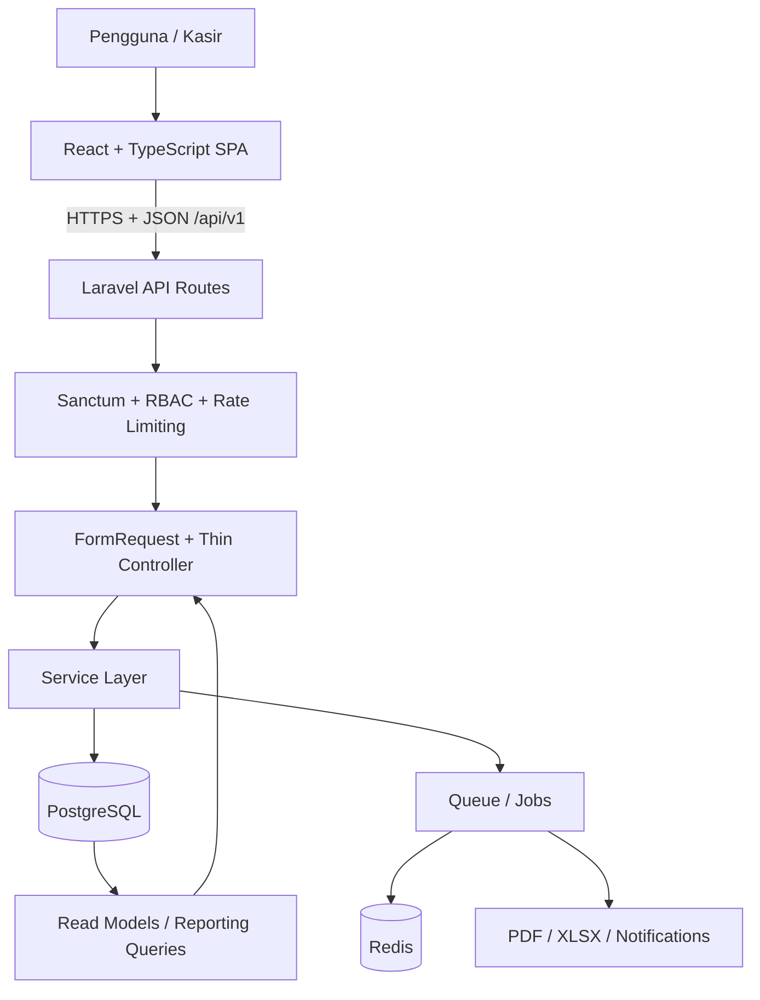
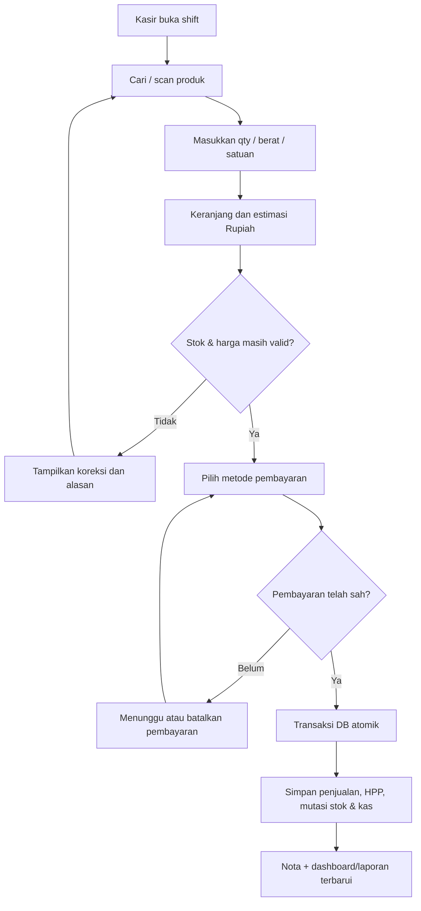
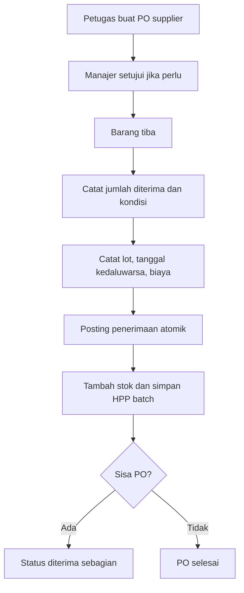
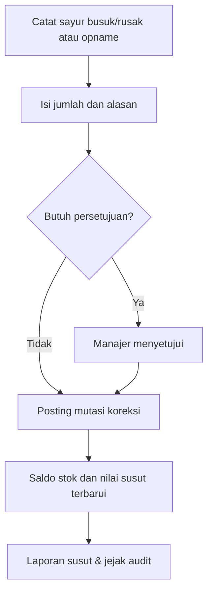
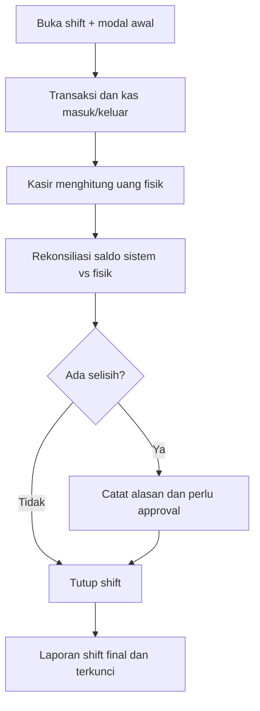
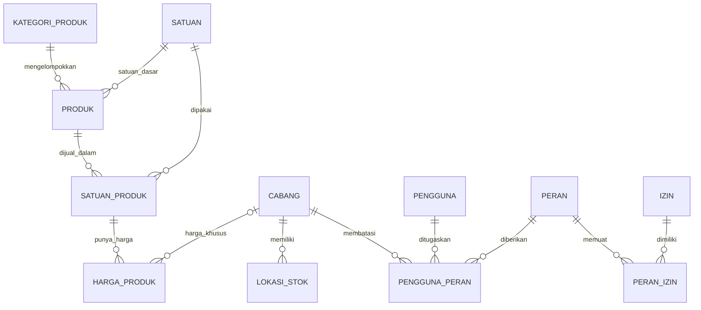
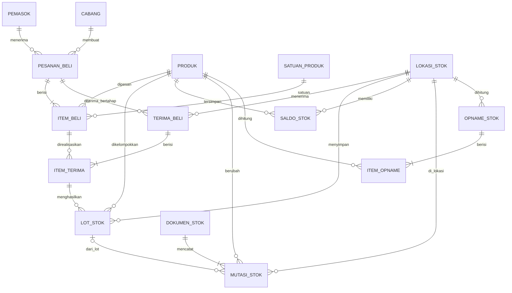
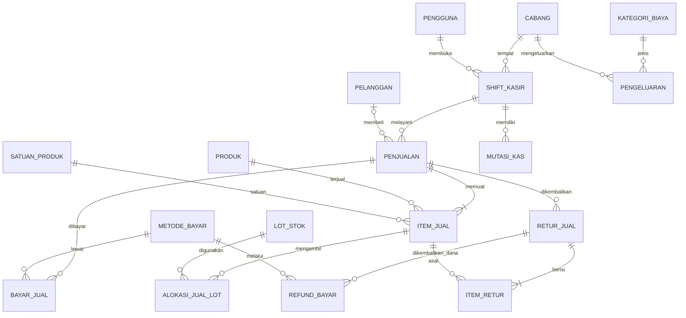

# KEBUN KITA — IMPLEMENTATION BLUEPRINT

**Versi dokumen:** 1.0 · **Tanggal:** 30 Oktober 2026  
**Aplikasi:** POS, Persediaan, Pembelian, Operasional, dan Laporan Toko Sayur Kebun Kita  
**Stack:** Laravel · React · TypeScript · PostgreSQL · RESTful API · Redis (opsional saat tahap awal, direkomendasikan untuk antrean/cache)  
**Nilai inti:** cepat, akurat, aman, mudah dimengerti, responsif, scalable.

## 1. Ruang Lingkup dan Keputusan Inti

- Bentuk aplikasi: **modular monolith**, satu backend Laravel dan frontend React SPA dengan REST API berversi `/api/v1`.
- Pelanggan awal: satu toko. Semua catatan operasional memiliki `cabang_id` sejak awal agar multi-cabang dapat ditambahkan tanpa merombak transaksi.
- Sumber kebenaran data: PostgreSQL dan Laravel Service Layer. React hanya menghitung pratinjau keranjang; angka transaksi final dihitung ulang pada server.
- Siklus kasir: buka shift -> jual -> bayar -> cetak nota -> tutup shift -> rekonsiliasi uang.
- Siklus stok: pesan/beli -> terima -> lot stok -> jual/susut/retur -> mutasi stok -> opname -> laporan.
- Produk dapat dijual per kg, gram, ikat, buah, bungkus, pack, atau satuan yang disetujui. Konversi tetap dan jumlah aktual dicatat dengan tepat.
- Mata uang tunggal Rupiah (`IDR`) pada rilis awal; UI `Rp`, format `id-ID`.
- Kontrol akses dan identitas selalu ditegakkan pada backend. Tidak menaruh secret pada browser.
- Testing fungsional/browser/acceptance sepenuhnya menjadi tanggung jawab developer manusia; agen hanya melakukan implementasi, typecheck, lint, build, dan inspeksi statis sesuai mandat.

## 2. Peran dan Alur Pemakai

| Peran | Fokus | Batas kewenangan |
|---|---|---|
| Pemilik | Semua cabang, dashboard, laba, konfigurasi | Hak tertinggi dengan MFA |
| Manajer | Setujui diskon besar, koreksi stok, retur, tutup kas | Sesuai cabang dan izin |
| Kasir | POS, pembayaran, nota, shift | Tidak boleh ubah HPP atau laporan historis |
| Gudang | Terima barang, opname, lot/kedaluwarsa, susut | Tidak melihat informasi keuangan sensitif jika tidak perlu |
| Pembelian | Supplier, pemesanan, penerimaan | Persetujuan harga/PO sesuai batas |
| Akuntansi | Rekonsiliasi pembayaran, biaya, laporan | Tidak mengubah transaksi selesai secara langsung |

## 3. Modul dan Prioritas Pengembangan

| Modul / Menu | Fitur utama | Prioritas |
|---|---|---|
| Dashboard | Omzet, transaksi, laba kotor, stok menipis, susut, produk terlaris, grafik tren, ringkasan kas | MVP |
| Kasir / POS | Katalog, pencarian SKU/barcode, timbangan manual, keranjang, diskon dengan izin, bayar tunai/non-tunai, split payment, nota, hold cart, retur | MVP (hold cart dan split dapat disempurnakan fase 2) |
| Produk | CRUD, SKU, barcode, gambar, kategori, satuan, harga dinamis, aktif/nonaktif, varian kemasan, harga bertanggal | MVP |
| Stok & Persediaan | Stok per lokasi, mutasi, lot/FEFO, batas minimum, susut/busuk, opname, kartu stok | MVP |
| Pembelian | Supplier, PO, penerimaan sebagian, biaya pembelian, HPP, pembayaran hutang pemasok | PO & terima MVP, hutang fase 2 |
| Pelanggan | Data, histori transaksi, harga grosir/loyalitas | Data dasar MVP, loyalitas fase 3 |
| Keuangan Operasional | Shift kas, kas masuk/keluar, biaya operasional, metode bayar, selisih kas | MVP |
| Laporan | Penjualan, detail item, metode bayar, stok, pembelian, HPP, laba, susut, rekonsiliasi, ekspor XLSX/CSV/PDF | MVP inti, lanjutan fase 2 |
| Pengguna & Keamanan | Auth, RBAC, MFA admin, audit, pembatasan akses cabang | MVP |
| Pengaturan | Profil toko, nomor dokumen, struk, satuan, kebijakan harga, pajak konfigurabel, notifikasi | MVP |
| Transfer antar Cabang | Transfer barang dua tahap, penerimaan, jejak audit | Fase 2 |
| Promosi | Voucher, diskon waktu tertentu, harga grosir, pelanggan loyal | Fase 2 |
| Integrasi | QRIS gateway, printer, label harga, barcode scanner, timbangan | Fase 2 sesuai hardware/provider |
| Peramalan | Rekomendasi restok, deteksi barang cepat rusak, tren musiman | Fase 3 |

**Navigasi desktop:** satu top navbar (Dashboard, Kasir, Produk, Stok, Pembelian, Keuangan, Laporan, Lainnya). **Navigasi mobile:** hamburger membuka sidebar drawer dengan menu yang sama. Menu disaring berdasarkan permission backend, tetapi proteksi utama tetap pada API.

## 4. Visual & UX Contract

Gunakan gambar referensi food dashboard yang diunggah sebagai *visual source of truth* untuk nuansa komponen dan kepadatan: kartu putih, dominasi mint/emerald, foto produk, soft border, radius membulat, dan ruang antar kartu minimal. Perubahan sengaja: desktop memakai top navbar, bukan sidebar permanen pada referensi.

### Design tokens awal (kalibrasi akhir terhadap gambar)

```css
:root {
  --kk-primary: #009f52;
  --kk-primary-dark: #007b40;
  --kk-bg: #f7faf8;
  --kk-mint: #e6f8ef;
  --kk-surface: #ffffff;
  --kk-border: #e3ece7;
  --kk-text: #14221b;
  --kk-radius: 14px;
  --kk-card-gap: 8px;
  --kk-card-padding: 14px;
}
```

- Desktop besar: topbar penuh, katalog 4–5 kolom, checkout panel kanan yang sticky dan dapat di-scroll mandiri.
- Desktop sedang/tablet: katalog 2–3 kolom, checkout panel adaptif.
- Mobile: 1–2 kolom bergantung lebar, sidebar drawer, checkout bottom sheet penuh, tombol bayar mudah dijangkau.
- Ukuran target sentuh ideal minimal 44×44 CSS pixel; konten dan tabel dengan overflow terkontrol.
- Gunakan spacing antar card 6–8px tanpa mengorbankan keterbacaan atau hit target.
- Skeleton per widget, angka KPI, grafik, baris tabel, kartu produk, foto dan detail, keranjang jika fetching server. Jangan mengganti seluruh layar dengan spinner saat satu widget loading.
- Submit: spinner kecil **di tombol yang diklik**, `disabled`, label aksi tetap jelas, cegah double submit. Jangan gunakan skeleton untuk menyamarkan mutasi.
- Empty state, error state, retry, akses ditolak, stok habis, harga berubah, dan sesi berakhir harus eksplisit dalam bahasa Indonesia sederhana.
- Antislop dibaca dan diterapkan oleh agen untuk ketelitian implementasi, bukan izin redesign.

## 5. Arsitektur Teknis



**Backend (contoh)**

```text
app/
  Http/
    Controllers/Api/V1/{ProdukController,PenjualanController,...}.php
    Requests/{Produk,SimpanPenjualan,...}.php
    Resources/{ProdukResource,PenjualanResource,...}.php
  Models/{Produk,Penjualan,ItemJual,MutasiStok,...}.php
  Services/
    Produk/{ProdukService,HargaService}.php
    Penjualan/{KasirService,PembayaranService,ReturService}.php
    Persediaan/{StokService,OpnameService,LotService}.php
    Pembelian/{PembelianService,PenerimaanService}.php
    Keuangan/{ShiftKasirService,PengeluaranService}.php
    Laporan/{LaporanJualService,LaporanStokService}.php
  Policies/
  Jobs/
  Support/{Uang,Qty,NomorDokumen}.php
routes/api.php
database/migrations/
```

**Frontend (contoh)**

```text
resources/js/
  app/
    router/
    providers/
  komponen/
    ui/{Tombol,Kartu,Skeleton,Tabel,Dialog}.tsx
    layout/{NavbarAtas,SidebarMobile,PanelKeranjang}.tsx
  fitur/
    kasir/{halaman,komponen,kait,api,tipe}/
    produk/{halaman,komponen,kait,api,tipe}/
    stok/{halaman,komponen,kait,api,tipe}/
    pembelian/{halaman,komponen,kait,api,tipe}/
    laporan/{halaman,komponen,kait,api,tipe}/
  layanan/{apiClient,auth}.ts
  util/{formatRupiah,formatQty}.ts
  tipe/
```

Tetap gunakan konvensi kelas PHP yang mudah dibaca, serta PSR-4/PascalCase untuk nama class. Nama file dan tabel bisnis berbahasa Indonesia; nama teknis framework seperti `Controller`, `Service`, `Resource`, `Request`, dan metadata Laravel tidak perlu dipaksakan menjadi terjemahan.

### Contoh alur backend

```text
POST /api/v1/penjualan
  -> PenjualanRequest::validate()
  -> PenjualanPolicy::create()
  -> PenjualanController::store()
  -> KasirService::selesaikanPenjualan()
       DB::transaction():
         validasi harga dan izin diskon
         lock stok yang relevan secara konsisten
         alokasi lot FEFO dan hitung HPP
         simpan penjualan + item snapshot
         simpan status pembayaran yang telah sah
         tulis dokumen_stok + mutasi_stok
         kurangi saldo_stok
         catat mutasi kas jika perlu
         simpan event/outbox untuk pekerjaan async
  -> PenjualanResource + HTTP 201
```

Jangan menganggap pembayaran gateway berstatus `pending` sebagai `paid`. Untuk QRIS/provider asynchronous, gunakan alur reservasi/pesanan menunggu pembayaran; finalisasi stok dilakukan sesuai kebijakan reservasi dan konfirmasi server-side provider, secara idempoten.

## 6. Workflow Bisnis

### 6.1. Penjualan kasir



**Status penjualan:** `draft` (keranjang tersimpan), `menunggu_bayar`, `selesai`, `batal`, `retur_sebagian`, `retur_penuh`. Tidak setiap status boleh berpindah ke semua status; gunakan transition rules pada service.

### 6.2. Pembelian dan penerimaan barang



### 6.3. Susut dan opname



### 6.4. Tutup shift



## 7. Konvensi Database PostgreSQL

- Tabel bisnis `snake_case` bahasa Indonesia, contohnya `produk`, `satuan_produk`, `penjualan`, `item_jual`, `mutasi_stok`, `shift_kasir`.
- PK `id` (UUID/ULID atau bigint konsisten); FK `<entitas>_id`. Untuk multi-cabang, gunakan `cabang_id` pada transaksi dan validasi silang agar referensi tidak tercampur antar-cabang.
- Kolom umum `dibuat_pada`, `diubah_pada`, `dibuat_oleh`; model Laravel harus mengonfigurasi nama timestamp khusus bila digunakan. Alternatif yang lebih kompatibel adalah tetap `created_at`/`updated_at` sebagai metadata framework.
- Uang transaksi `numeric(18,0)` (Rupiah bulat); kuantitas `numeric(18,3)` untuk kg dengan presisi gram; konversi `numeric(20,6)`; HPP per satuan dasar `numeric(20,6)`.
- Serialize angka desimal dari REST API sebagai **string** (`"18000"`, `"0.275"`) untuk menghindari kesalahan float JavaScript. Gunakan perhitungan desimal eksak pada backend dan aturan pembulatan yang terdokumentasi.
- Waktu kejadian `timestamptz` disimpan dengan standar UTC; UI memakai `Asia/Jakarta` (ubah per cabang jika dibutuhkan).
- Gunakan FK, UNIQUE, NOT NULL, CHECK (qty > 0, harga >= 0, status valid), transaksi atomik, dan indeks berbasis query riil.
- Transaksi selesai jangan dihapus/edit bebas: koreksi menggunakan retur, reversal, atau dokumen penyesuaian berjejak audit.
- Kode dokumen unik per cabang/tahun (mis. `KKB-2026-000001`) dibuat aman terhadap concurrent writes.
- Mulai sebagai satu entitas usaha, tetapi semua report berbasis `cabang_id`, sehingga bisa agregasi multi-cabang.

## 8. Kamus Tabel & Relasi Utama

**Master dan akses**

| Tabel | Kolom penting | Relasi / fungsi |
|---|---|---|
| `cabang` | `id`, `kode`, `nama`, `alamat`, `zona_waktu` | 1:n lokasi stok, transaksi, shift |
| `pengguna` | `id`, `nama`, `email`, `sandi_hash`, `aktif` | 1:n transaksi, audit, shift |
| `peran` | `id`, `kode`, `nama` | n:m pengguna via `pengguna_peran` |
| `izin` | `id`, `kode`, `nama` | n:m peran via `peran_izin` |
| `pengguna_peran` | `pengguna_id`, `peran_id`, `cabang_id` | scope per cabang |
| `peran_izin` | `peran_id`, `izin_id` | hak aksi, bukan sekadar menu |
| `pemasok` | `id`, `nama`, `kontak`, `aktif` | 1:n pesanan beli |
| `pelanggan` | `id`, `nama`, `telepon` | 1:n penjualan, boleh null |
| `pengaturan_toko` | `id`, `cabang_id`, `kunci`, `nilai_json` | konfigurasi bisnis tervalidasi |
| `audit_aksi` | `id`, `pengguna_id`, `aksi`, `entitas`, `id_entitas`, `data_lama`, `data_baru` | audit append-only |

**Produk & harga**

| Tabel | Kolom penting | Relasi / fungsi |
|---|---|---|
| `kategori_produk` | `id`, `nama`, `induk_id` | 1:n produk, kategori bertingkat |
| `satuan` | `id`, `kode`, `nama`, `jenis` | kg, gram, ikat, buah, pak |
| `produk` | `id`, `kategori_produk_id`, `satuan_dasar_id`, `sku`, `nama`, `tipe_jual`, `aktif` | 1:n satuan produk, lot, harga |
| `satuan_produk` | `id`, `produk_id`, `satuan_id`, `faktor_ke_dasar`, `barcode` | satuan yang boleh dijual/diterima |
| `harga_produk` | `id`, `satuan_produk_id`, `cabang_id`, `jenis_harga`, `harga_rp`, `mulai_pada`, `akhir_pada` | riwayat harga berlaku |
| `riwayat_produk` | `id`, `produk_id`, `pengguna_id`, `perubahan_json` | perubahan data master; opsional jika audit mencukupi |

**Pembelian & persediaan**

| Tabel | Kolom penting | Relasi / fungsi |
|---|---|---|
| `lokasi_stok` | `id`, `cabang_id`, `kode`, `nama` | gudang, rak, area toko |
| `pesanan_beli` | `id`, `pemasok_id`, `cabang_id`, `nomor`, `status`, `total_rp` | PO |
| `item_beli` | `id`, `pesanan_beli_id`, `produk_id`, `satuan_produk_id`, `qty`, `harga_rp` | rincian PO |
| `terima_beli` | `id`, `pesanan_beli_id`, `lokasi_stok_id`, `waktu_terima` | penerimaan parsial |
| `item_terima` | `id`, `terima_beli_id`, `item_beli_id`, `qty`, `biaya_rp`, `kedaluwarsa_pada` | barang fisik diterima |
| `lot_stok` | `id`, `produk_id`, `lokasi_stok_id`, `item_terima_id`, `kode_lot`, `qty_sisa`, `hpp_dasar` | stok batch FEFO, asal penerimaan |
| `saldo_stok` | `id`, `produk_id`, `lokasi_stok_id`, `qty_dasar` | saldo cepat, diturunkan dari mutasi |
| `dokumen_stok` | `id`, `cabang_id`, `jenis`, `nomor`, `waktu_posting` | induk setiap perubahan stok; referensi typed FK dapat ditambah sesuai sumber |
| `mutasi_stok` | `id`, `dokumen_stok_id`, `produk_id`, `lokasi_stok_id`, `lot_stok_id`, `qty_delta`, `nilai_hpp_rp` | ledger penambahan/pengurangan immutable |
| `opname_stok` | `id`, `lokasi_stok_id`, `status`, `waktu_hitung` | pembanding stok sistem dan fisik |
| `item_opname` | `id`, `opname_stok_id`, `produk_id`, `lot_stok_id`, `qty_sistem`, `qty_fisik` | selisih otomatis |
| `susut_stok` | `id`, `lokasi_stok_id`, `alasan`, `status` | pengajuan susut, di-posting ke ledger |
| `item_susut` | `id`, `susut_stok_id`, `lot_stok_id`, `qty`, `nilai_hpp_rp` | sayur rusak, busuk, terbuang |

**Penjualan dan kas**

| Tabel | Kolom penting | Relasi / fungsi |
|---|---|---|
| `shift_kasir` | `id`, `cabang_id`, `pengguna_id`, `modal_awal_rp`, `saldo_fisik_rp`, `status` | sesi kasir |
| `penjualan` | `id`, `nomor`, `cabang_id`, `shift_kasir_id`, `pelanggan_id`, `status`, `subtotal_rp`, `diskon_rp`, `pajak_rp`, `total_rp` | header transaksi & snapshots |
| `item_jual` | `id`, `penjualan_id`, `produk_id`, `satuan_produk_id`, `nama_snapshot`, `qty`, `harga_snapshot_rp`, `diskon_rp`, `total_rp`, `hpp_rp` | item tidak berubah setelah selesai |
| `alokasi_jual_lot` | `id`, `item_jual_id`, `lot_stok_id`, `qty_dasar`, `hpp_rp` | pemakaian lot FEFO/FIFO |
| `metode_bayar` | `id`, `kode`, `nama`, `jenis`, `aktif` | tunai, transfer, QRIS provider |
| `bayar_jual` | `id`, `penjualan_id`, `metode_bayar_id`, `nilai_rp`, `status`, `ref_eksternal` | 1:n metode/split payment |
| `retur_jual` | `id`, `penjualan_id`, `nomor`, `status`, `alasan` | retur sebagian/penuh |
| `item_retur` | `id`, `retur_jual_id`, `item_jual_id`, `qty`, `nilai_refund_rp`, `layak_jual` | retur terkait item asal |
| `refund_bayar` | `id`, `retur_jual_id`, `metode_bayar_id`, `nilai_rp`, `status` | pembayaran dana balik |
| `kategori_biaya` | `id`, `nama` | listrik, plastik, transportasi |
| `pengeluaran` | `id`, `cabang_id`, `kategori_biaya_id`, `nilai_rp`, `waktu`, `status` | biaya operasional |
| `mutasi_kas` | `id`, `shift_kasir_id`, `jenis`, `masuk_rp`, `keluar_rp`, `nomor_ref` | rekonsiliasi cash fisik; jangan hitung seluruh metode non-tunai |

**Fase lanjut**: `transfer_stok`, `item_transfer`, `promosi`, `aturan_promosi`, `promo_produk`, `utang_pemasok`, `bayar_pemasok`, `penyesuaian_harga_masal`, `loyalitas_pelanggan`, `integrasi_bayar`, `webhook_masuk`, `pekerjaan_ekspor`, `notifikasi`, `outbox_peristiwa`.

## 9. Entity Relationship Diagram (ERD)

### 9A. Master produk, harga, user, cabang



### 9B. Pembelian, lot, persediaan



### 9C. Penjualan, retur, pembayaran, kas



**Kaidah kardinalitas:** 1 cabang memiliki banyak shift. 1 penjualan memiliki banyak item dan pembayaran. 1 produk dapat memiliki beberapa satuan jual dan riwayat harga. 1 pesanan beli dapat diterima berkali-kali. 1 item terjual dapat mengonsumsi beberapa lot agar HPP akurat.

## 10. Aturan Bisnis yang Harus Diputuskan dan Dibakukan

### 10.1 Satuan dan harga fleksibel

- Contoh `Wortel`: satuan dasar `kg`, satuan jual `kg` dan `gram` (faktor gram→kg = `0.001`), atau `bungkus 500 g` (faktor `0.5`) bila berat kemasan tetap.
- Contoh `Bayam`: satuan dasar `ikat`, satuan jual `ikat` dan `pak 5 ikat` (faktor `5`). Jangan menebak konversi ikat↔kg; hanya boleh jika berat aktual ditimbang.
- Harga bisa berbeda menurut satuan jual, periode, cabang, dan segmen harga (ecer/grosir). Cegah dua harga aktif tumpang tindih untuk kombinasi sama (constraint/range bila perlu).
- Harga transaksi disalin ke `item_jual.harga_snapshot_rp`; perubahan harga setelah transaksi tidak mengubah riwayat.
- Contoh tepat: `0,275 kg × Rp18.000/kg = Rp4.950`.
- Hitung desimal presisi tinggi di server; pembulatan Rupiah di setiap line item mengikuti aturan tetap (mis. HALF_UP). Total = jumlah total item + biaya/pajak - diskon, bukan nilai floating browser.
- Seluruh diskon/promo harus divalidasi server, memiliki prioritas aturan, dan memiliki batas izin pengguna.

### 10.2 HPP dan lot

- Pilih **FEFO (first expired, first out)** untuk pengeluaran stok fisik agar sayur tidak cepat busuk; untuk HPP, gunakan biaya aktual lot teralokasi bila produk dibeli dengan harga batch yang berbeda.
- Lot stok diidentifikasi dari barang diterima, lokasi, batch, tanggal terima, kedaluwarsa bila ada, dan HPP per unit dasar.
- Untuk barang tanpa kedaluwarsa, alokasi berdasarkan waktu terima FIFO.
- Karena satu item penjualan bisa mengambil stok dari dua lot, HPP item = jumlah nilai HPP alokasi di `alokasi_jual_lot`.
- Stock opname dan susut ditulis sebagai mutasi positif/negatif; jangan edit saldo tanpa ledger.
- Retur barang hanya menambah stok jika kondisi dinyatakan layak jual. Barang rusak dicatat sebagai retur finansial tanpa menambah stok tersedia.

### 10.3 Status, race conditions, dan pembayaran

- Tulis transaksi secara atomik memakai `DB::transaction()`; lock saldo/lot relevan (`FOR UPDATE`) dengan urutan stabil untuk mencegah overselling.
- Gunakan `Idempotency-Key` unik per cabang/permintaan operasi kritis agar klik ulang atau retry network tidak menciptakan penjualan ganda.
- Untuk pembayaran provider, cocokkan webhook signature, referensi transaksi, jumlah, status, dan idempotensi event. Jangan percaya status pembayaran dari frontend.
- Jika pembayaran belum sah, penjualan berada pada status menunggu; jangan menandainya selesai atau mengurangi stok final tanpa kebijakan reservasi yang eksplisit.
- Jika pembayaran eksternal sukses tetapi posting stok gagal, lakukan recovery terukur melalui antrean/outbox dan workflow rekonsiliasi; jangan membuang bukti pembayaran.
- Pembatalan penjualan selesai dilakukan dengan reversal resmi dan audit, bukan mengubah angka historis secara diam-diam.

### 10.4 Tutup kas

- `kas_seharusnya = modal_awal + kas_tunai_diterima - kembalian - kas_keluar + kas_masuk_manual - refund_tunai`.
- Pembayaran transfer/QRIS tidak dihitung sebagai uang tunai fisik di laci.
- `selisih_kas = saldo_fisik - kas_seharusnya`; jika bukan nol, minta alasan dan persetujuan sesuai ambang.
- Laporan keuangan harus memisahkan **penjualan**, **penerimaan uang**, **pembelian stok**, **HPP terjual**, **susut**, dan **biaya operasional** supaya tidak menghitung ganda.

## 11. REST API Contract Awal

### Konvensi

- Prefix `/api/v1`, JSON, bahasa internal endpoint Indonesia, resource plural konsisten (`/produk`, `/penjualan`, `/pembelian`, `/stok`).
- GET aman dan tidak mengubah data; POST membuat/aksi; PATCH partial update; DELETE untuk master nontransaksional yang layak dihapus secara aman.
- HTTP 201 create, 200 success, 204 empty, 400 invalid request, 401 unauthenticated, 403 unauthorized, 404 not found, 409 conflict/stock-price changed, 422 validation, 429 rate limit.
- Filter `?cabang_id=...&q=...&halaman=...&per_halaman=...` hanya dalam scope cabang yang boleh diakses.
- Pagination cursor untuk dataset besar, pagination biasa untuk tabel dengan kebutuhan page number.
- Response error menyertakan kode mesin + pesan manusia dalam Bahasa Indonesia + field errors, tanpa stacktrace.

| Method | Endpoint | Kegunaan |
|---|---|---|
| GET | `/api/v1/dashboard/ringkasan` | KPI dan ringkasan |
| GET | `/api/v1/dashboard/tren` | data grafik sesuai filter |
| GET/POST | `/api/v1/produk` | daftar / tambah produk |
| GET/PATCH | `/api/v1/produk/{id}` | detail / ubah produk |
| GET/POST | `/api/v1/produk/{id}/harga` | baca / jadwalkan harga |
| GET | `/api/v1/stok/saldo` | saldo per produk/lokasi |
| GET | `/api/v1/stok/mutasi` | kartu stok |
| POST | `/api/v1/stok/opname` | mulai opname |
| POST | `/api/v1/stok/opname/{id}/posting` | terapkan selisih stok |
| POST | `/api/v1/stok/susut` | ajukan/catat susut |
| GET/POST | `/api/v1/pembelian` | PO |
| POST | `/api/v1/pembelian/{id}/penerimaan` | barang tiba |
| POST | `/api/v1/shift-kasir` | buka shift |
| POST | `/api/v1/shift-kasir/{id}/tutup` | tutup kas |
| POST | `/api/v1/penjualan` | buat/selesaikan penjualan sesuai model transaksi |
| GET | `/api/v1/penjualan/{id}` | lihat nota |
| POST | `/api/v1/penjualan/{id}/retur` | buat retur |
| GET | `/api/v1/laporan/penjualan` | tabel laporan |
| GET | `/api/v1/laporan/laba-rugi` | laporan ringkas |
| POST | `/api/v1/laporan/ekspor` | antre ekspor CSV/XLSX/PDF |
| GET | `/api/v1/laporan/ekspor/{id}` | status dan tautan ekspor aman |

**Contoh request penjualan** (harga dari client hanya pratinjau, dihitung ulang server):

```json
{
  "cabang_id": "01...",
  "shift_kasir_id": "01...",
  "pelanggan_id": null,
  "item": [
    { "satuan_produk_id": "01...", "qty": "0.275" },
    { "satuan_produk_id": "02...", "qty": "2" }
  ],
  "pembayaran": [
    { "metode_bayar_id": "TUNAI", "nilai_rp": "15000" }
  ]
}
```

Header `Idempotency-Key` wajib untuk POST finalisasi. Endpoint transaksi kompleks sebaiknya menyatakan intent secara jelas, mis. `/penjualan/{id}/selesaikan`, agar state transition eksplisit.

**Contoh response terstandar**

```json
{
  "data": {
    "id": "01...",
    "nomor": "KKB-2026-000001",
    "status": "selesai",
    "total_rp": "15000",
    "mata_uang": "IDR"
  },
  "meta": { "waktu_server": "2026-10-30T12:00:00Z" }
}
```

## 12. Cybersecurity / Reliability Requirements

| Lapisan | Kontrol wajib |
|---|---|
| Login | Sanctum SPA cookie HttpOnly/Secure/SameSite, CSRF, session rotation, login throttling |
| Admin | MFA, sensitive-action reauthentication bila perlu, logout semua sesi |
| Authorization | RBAC + Laravel Policies per operasi, ownership/cabang check per record (anti BOLA/IDOR) |
| Input | FormRequest validation, allow-list filter/sort, file MIME/content/size validation, no mass assignment |
| SQL & XSS | Parameterized SQL/Eloquent, output escaping, CSP, hindari raw HTML tidak tepercaya |
| API | HTTPS, rate limit, request size limit, CORS origin ketat, OpenAPI, versioning |
| Data | PostgreSQL least-privilege account, secrets manager/env private, backup terenkripsi, restore drill |
| Integritas | Database FK/UNIQUE/CHECK, row locks, transactions, idempotency, audit append-only |
| Provider pembayaran | Signed webhook, timestamp check, replay protection, verifikasi jumlah dan identitas merchant |
| Monitoring | Structured logs, correlation ID, alert kegagalan job, backup, ruang disk, DB slow queries |
| File laporan | Otorisasi akses, short-lived signed URL, antivirus bila mengizinkan unggah, batas ukuran export |
| Perilaku sistem | Tangani jaringan putus, expired session, stock conflict, double click, pending payment, retry idempoten |

Prioritas ancaman mengikuti OWASP API Security Top 10, terutama Broken Object Level Authorization, Broken Authentication, Broken Function Level Authorization, dan Unrestricted Resource Consumption.

## 13. Akurasi Laporan dan Dashboard

| KPI | Rumus / sumber data | Catatan |
|---|---|---|
| Omzet bersih | total penjualan selesai - nilai retur bersih | Pencatatan diskon/pajak konsisten dan terpisah |
| Total transaksi | count penjualan `selesai` dalam periode | Retur/batal ditampilkan terpisah |
| Item terjual | sum qty berdasarkan satuan dasar | Hati-hati jangan jumlahkan kg dan ikat menjadi satu |
| Laba kotor | omzet bersih (basis sebelum/di luar pajak pungutan) - HPP bersih | HPP berasal dari alokasi lot dan koreksi retur |
| Laba operasional | laba kotor - biaya operasional - susut yang belum terhitung di HPP | Tentukan kebijakan klasifikasi susut agar tidak double count |
| Nilai persediaan | sum qty sisa lot × HPP unit lot | Rekonsiliasi dengan ledger |
| Susut | qty dan nilai HPP item susut | Tampilkan persentase dari penerimaan/penjualan dengan definisi jelas |
| Stok minimum | saldo stok dibanding batas minimum | Per cabang dan satuan dasar |
| Kas selisih | saldo fisik dikurangi saldo seharusnya | Non-tunai dikecualikan |
| Top produk | volume/sales atau margin per produk | Beri toggle basis pemeringkatan |
| Pembelian | total barang diterima dan nilai kewajiban pembelian | PO belum diterima tidak sama dengan persediaan |

Laporan harus memiliki filter periode, cabang, kategori, produk, kasir, metode pembayaran, status, dan ekspor dengan parameter yang sama. Dashboard menggunakan endpoint agregasi yang bersumber dari data transaksi resmi. Untuk trafik besar, gunakan rollup/materialized views atau tabel agregat terkontrol, dengan mekanisme invalidasi dan rekonsiliasi ke ledger.

**Zona waktu pelaporan:** tetapkan batas hari berdasarkan timezone cabang, lalu lakukan filter timestamp aman di UTC. Ekspor menampilkan periode, cabang, mata uang, waktu generate, filter, dan status pencatatan final.

## 14. Loading, Error, dan Interaction Contract

| Kondisi | Pola UI |
|---|---|
| Memuat daftar produk | skeleton gambar, nama, harga, dan tombol di tiap card |
| Memuat dashboard | skeleton spesifik di setiap KPI/graph, bukan satu blok besar |
| Memuat tabel | skeleton per baris/kolom; header dan filter tetap terlihat |
| Memuat detail/form | skeleton per field dan section |
| Menyimpan produk | spinner kecil dalam tombol `Simpan`, tombol disabled |
| Finalisasi pembayaran | spinner tombol bayar, kunci double submit, status hasil diverifikasi server |
| Operasi ekspor panjang | job async, progress/status yang jelas, notifikasi selesai |
| Gagal request | pesan penyebab, retry aman, jangan hilangkan input form |
| Stok/harga berubah | konflik 409 dengan nilai baru dan pilihan konfirmasi ulang |
| Tidak ada data | empty state berbahasa Indonesia dan aksi yang sesuai |

Jangan gunakan spinner global bila hanya sebagian data sedang di-refetch. Placeholder skeleton harus menjaga dimensi layout agar tidak bergeser.

## 15. Fase Implementasi & Dependency

| Fase | Keluaran | Dependensi / gate |
|---|---|---|
| 0. Discovery | Definisi proses toko, glosarium, aturan satuan, HPP, kebijakan retur, pembayaran | disetujui developer |
| 1. Foundation | Repo, Laravel, React TS, Vite, PostgreSQL, env, linter/build, design system, OpenAPI starter | aplikasi dasar siap compile |
| 2. Auth & Cabang | Session Sanctum, pengguna, RBAC, policy, cabang, audit | hak akses aman |
| 3. Master Data | kategori, satuan, produk, barcode, harga historis, supplier, pelanggan | catalog siap digunakan |
| 4. Stok & Pembelian | PO, penerimaan, lot, saldo, mutasi, FEFO, opname/susut | ledger stok akurat |
| 5. POS | UI referensi, keranjang, qty timbang, diskon, kasir shift, cash payment, nota | penjualan atomik dan auditable |
| 6. Pembayaran & Retur | non-tunai manual, split, retur/refund, idempotensi, rekonsiliasi | status bayar konsisten |
| 7. Dashboard & Laporan | KPI, charts, laporan detail, export XLSX/PDF async | angka reconcile ke source |
| 8. Hardening | observability, backup, indeks, query optimization, control access review | developer acceptance |
| 9. Expansion | multi-cabang transfers, supplier payable, loyalty, gateway QRIS, forecasting | dijadwalkan setelah inti stabil |

**Aturan kerja AI agent:** inspeksi kode -> implementasi satu modul -> typecheck/lint/build -> dokumentasi berkas & API -> handover untuk testing developer. Agen **tidak menjalankan** unit/integration/E2E/browser tests jika mandat testing tetap pada developer. Jangan menyebut aplikasi bebas bug hanya karena build sukses.

## 16. Manual Acceptance Checklist untuk Developer

- [ ] Perubahan harga tidak mengubah harga transaksi historis.
- [ ] 0,275 kg pada Rp18.000/kg dihitung menjadi Rp4.950.
- [ ] Penjualan bersamaan dari dua kasir tidak menyebabkan stok negatif/overselling.
- [ ] Retry klik bayar tidak membuat dua penjualan (idempotensi).
- [ ] Penerimaan PO sebagian membuat saldo dan lot sesuai jumlah yang benar-benar diterima.
- [ ] FEFO memprioritaskan lot dengan tanggal kedaluwarsa lebih dekat.
- [ ] Retur layak jual mengembalikan stok; retur rusak tidak.
- [ ] Item yang terjual dari beberapa lot mempunyai HPP total yang benar.
- [ ] Shift tunai cocok dengan uang fisik, pembayaran QRIS tidak masuk kas tunai.
- [ ] Pengguna cabang A tidak bisa membaca/mengubah transaksi cabang B tanpa izin.
- [ ] Dashboard, tabel, XLSX, dan PDF memberikan angka sama untuk filter yang identik.
- [ ] Skeleton granular, spinner submit, error/retry, kosong, dan responsive bekerja.
- [ ] Menu desktop topbar dan mobile drawer konsisten dengan reference style.
- [ ] Backup dan restore bisa dipulihkan; audit kritikal tak dapat dihapus pengguna biasa.

## 17. Hal yang Perlu Dikunci sebelum Coding

1. Gunakan satu cabang aktif pada MVP, tetapi desain data multi-cabang-ready.
2. Pilih FEFO lot dengan HPP lot aktual, bukan rata-rata bergerak, kecuali kebijakan akuntansi usaha menetapkan sebaliknya.
3. Untuk MVP utamakan pembayaran tunai dan transfer/QRIS **dengan verifikasi status yang benar**; integrasi gateway otomatis fase berikutnya.
4. Tetapkan apakah stok dikurangi saat pembayaran final atau saat pesanan berstatus siap (rekomendasi POS konvensional: saat transaksi selesai).
5. Tetapkan metode pembulatan Rupiah, kebijakan pajak sesuai aturan yang berlaku untuk usaha, batas diskon, dan proses retur.
6. Mulai tanpa mode penjualan offline penuh. Offline-first pada POS multi-kasir memerlukan sinkronisasi, alokasi nomor, konflik stok dan pembayaran yang jauh lebih rumit.

---

## Referensi Teknologi

- Laravel Sanctum (SPA auth): https://laravel.com/framework/docs/sanctum
- Laravel Database Transactions: https://laravel.com/framework/docs/database
- PostgreSQL Numeric Types: https://www.postgresql.org/docs/current/datatype-numeric.html
- PostgreSQL Row Locking: https://www.postgresql.org/docs/current/explicit-locking.html
- OWASP API Top 10: https://owasp.org/API-Security/
- React + TypeScript: https://react.dev/learn/typescript
