<p align="center">
  
</p>

<p align="center">
  <b>Sistem kasir, persediaan FEFO, pembelian, dan laporan untuk toko sayur &amp; buah.</b><br>
  Dibangun dengan Laravel, React, dan PostgreSQL. Siap dijalankan di VPS lewat Docker &amp; Dokploy.
</p>

<p align="center">
  
  
  
  
  
  
</p>

<p align="center">
  <a href="#-sekilas">Sekilas</a> •
  <a href="#-fitur">Fitur</a> •
  <a href="#-galeri">Galeri</a> •
  <a href="#-arsitektur">Arsitektur</a> •
  <a href="#-mulai-cepat">Mulai Cepat</a> •
  <a href="#-referensi-api">API</a> •
  <a href="#-deploy-ke-vps-dengan-dokploy">Deploy</a> •
  <a href="#-pemecahan-masalah">Bantuan</a>
</p>

<p align="center">
  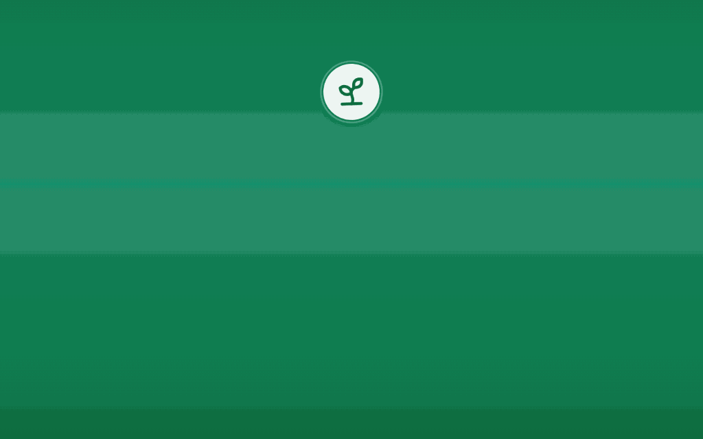
</p>


## 🌱 Sekilas

Toko sayur punya masalah yang tidak dimiliki toko biasa: barang dijual per kilogram, cepat busuk, dan harganya berubah-ubah. **Kebun Kita POS** dibuat untuk masalah itu.

| | |
|---|---|
| ⚖️ **Jual timbang & satuan** | Kuantitas desimal sampai 3 angka, misalnya `0,275 kg × Rp 18.000 = Rp 4.950`. |
| 🥬 **Anti barang busuk** | Stok keluar otomatis dari lot yang paling cepat kedaluwarsa (FEFO). |
| 💰 **Laba yang sebenarnya** | HPP dihitung dari lot yang benar-benar terjual, bukan harga rata-rata. |
| 🔔 **Tahu saat itu juga** | Setiap penjualan langsung muncul di lonceng semua perangkat cabang. |
| 🧾 **Struk thermal 80mm** | Rapi, hitam murni, dan panjangnya mengikuti isi nota. |
| 🖥️ **Satu sistem, banyak cabang** | Data, stok, dan shift terpisah per cabang. |

**Angka proyek saat ini:** 65 endpoint REST, 41 tabel domain, 9 menu aplikasi, 5 layanan Docker.


## ✨ Fitur

<table>
<tr>
<td width="50%" valign="top">

### 🛒 Kasir (POS)
- Katalog per halaman dengan pencarian nama, SKU, dan barcode di server
- Produk timbang lewat dialog berat, dengan tombol cepat `0,1 – 2 kg`
- Keranjang dengan animasi foto terbang, ubah jumlah, dan hapus item
- Tipe pesanan: di tempat, bawa pulang, kirim, kustom
- Diskon nota, pajak, dan member pelanggan
- Multi metode bayar dengan hitung kembalian otomatis
- Shift kasir: buka, tutup, rekonsiliasi kas, dan mutasi kas laci
- Nota thermal 80mm siap cetak

</td>
<td width="50%" valign="top">

### 📦 Persediaan
- Lot stok dengan tanggal kedaluwarsa dan urutan FEFO
- Ledger mutasi stok yang tidak bisa diubah (append-only)
- Stock opname dengan penyesuaian selisih
- Pencatatan susut barang rusak atau busuk
- Transfer stok antar cabang (API)
- Beberapa lokasi: gudang, rak toko, retur

</td>
</tr>
<tr>
<td valign="top">

### 🚚 Pembelian
- Pesanan beli (PO) dari pemasok
- Persetujuan PO
- Penerimaan barang yang otomatis membuat lot dan saldo
- Kode lot dan tanggal kedaluwarsa per penerimaan

</td>
<td valign="top">

### ↩️ Retur & Refund
- Cari nota lalu pilih item yang diretur
- Pemilahan barang layak jual dan rusak
- Refund ke metode bayar yang dipilih
- Riwayat retur dengan pencarian di server

</td>
</tr>
<tr>
<td valign="top">

### 📊 Dashboard & Laporan
- KPI hari ini dengan perbandingan terhadap kemarin
- Tren omzet dan laba: 7 hari, 4 minggu, 6 bulan
- Pangsa kategori dan metode bayar
- Produk terlaris dan status toko
- Rekap penjualan dan laba rugi per periode
- Ekspor CSV

</td>
<td valign="top">

### 🔐 Akun & Keamanan
- Login sesi Sanctum dengan cookie HttpOnly dan CSRF
- Peran: pemilik, manajer, kasir, gudang
- Scope cabang untuk mencegah akses lintas cabang
- Log audit untuk aksi sensitif
- Security header dan pembatasan percobaan login

</td>
</tr>
</table>

### 🎨 Pengalaman pengguna

- **Animasi di seluruh aplikasi:** angka berjalan, kartu miring mengikuti kursor, grafik tumbuh, dan transisi halaman. Otomatis berkurang bila perangkat mengaktifkan *reduce motion*.
- **Popup alert informatif:** sukses, gagal, perhatian, info, dan konfirmasi. Bisa ditutup dengan Esc atau klik latar, dan hitung mundurnya berhenti saat disorot.
- **Pagination di server:** setiap daftar hanya memuat satu halaman data, dengan ukuran halaman maksimal 100 baris.
- **Responsif:** nyaman dari layar HP sampai monitor kasir, termasuk laptop 1366×768.


## 🖼️ Galeri

<table>
<tr>
<td width="50%"><b>Dashboard</b><br>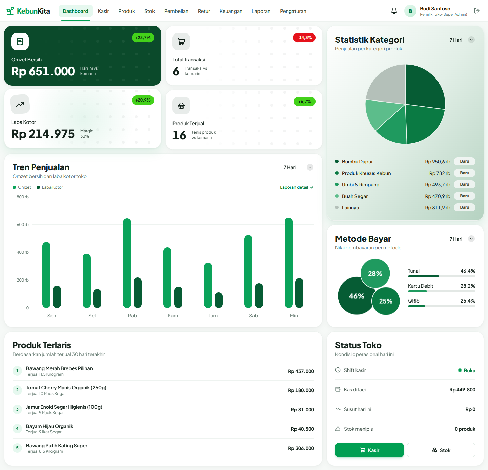</td>
<td width="50%"><b>Kasir</b><br>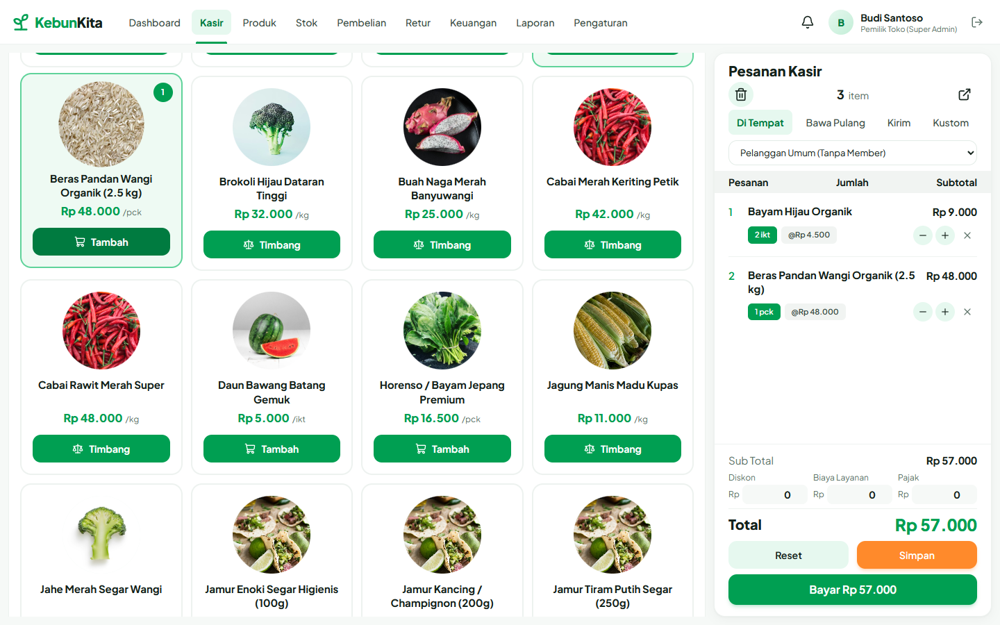</td>
</tr>
<tr>
<td><b>Notifikasi transaksi realtime</b><br>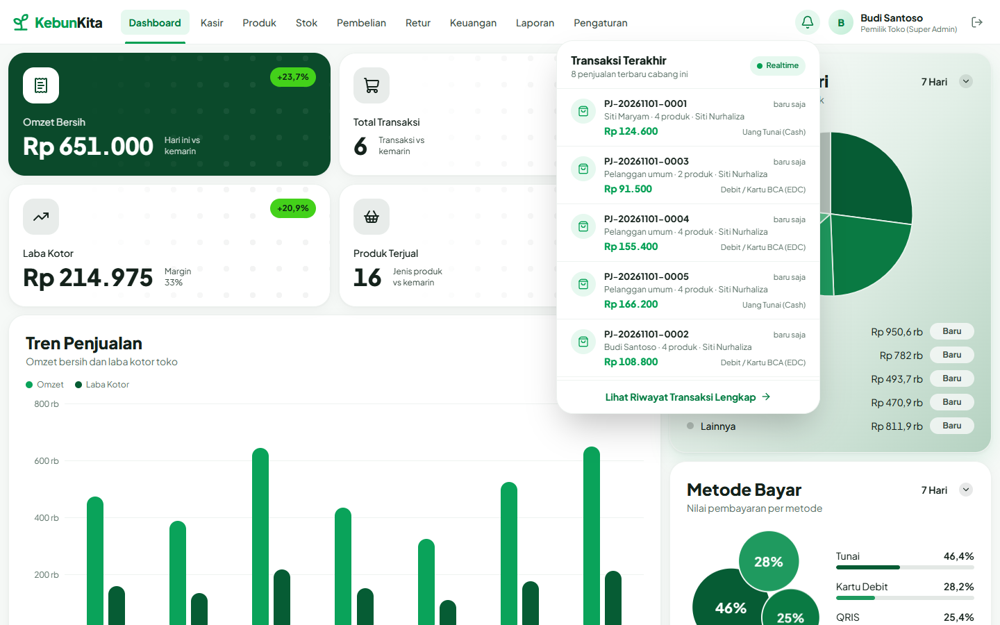</td>
<td><b>Pembayaran</b><br>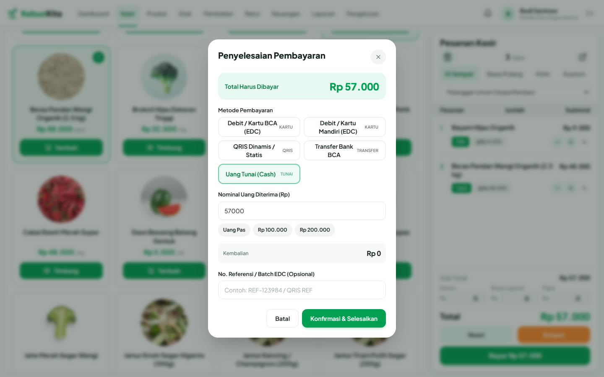</td>
</tr>
<tr>
<td><b>Nota thermal</b><br>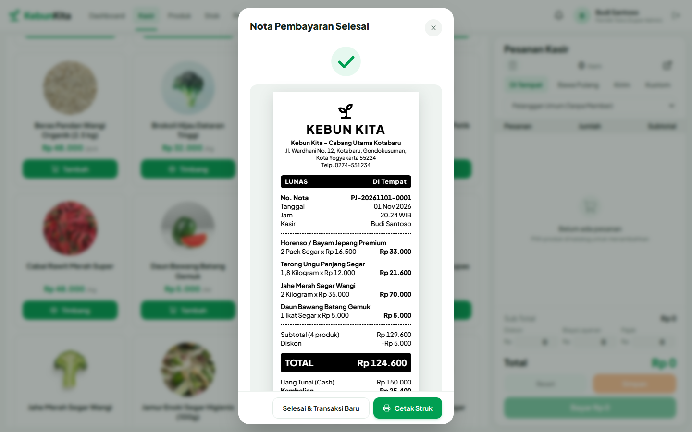</td>
<td><b>Popup alert</b><br>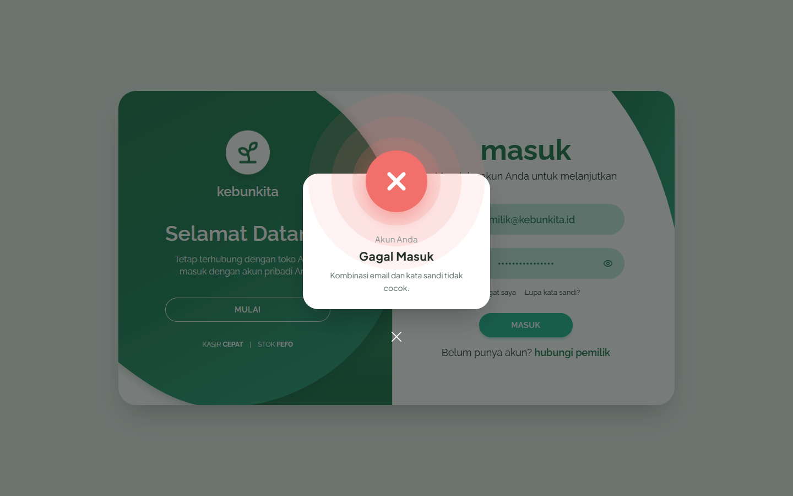</td>
</tr>
<tr>
<td><b>Login</b><br>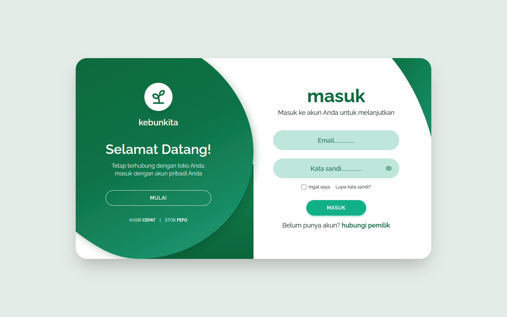</td>
<td><b>Laporan</b><br>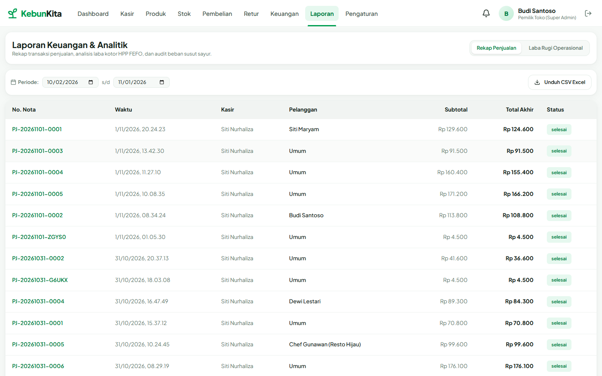</td>
</tr>
<tr>
<td><b>Produk</b><br>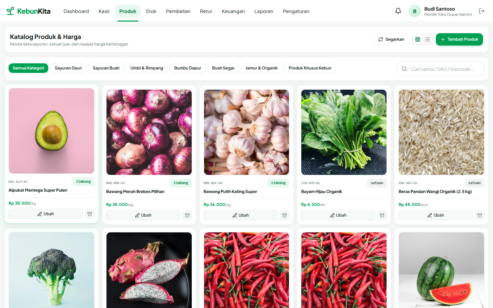</td>
<td><b>Stok FEFO</b><br>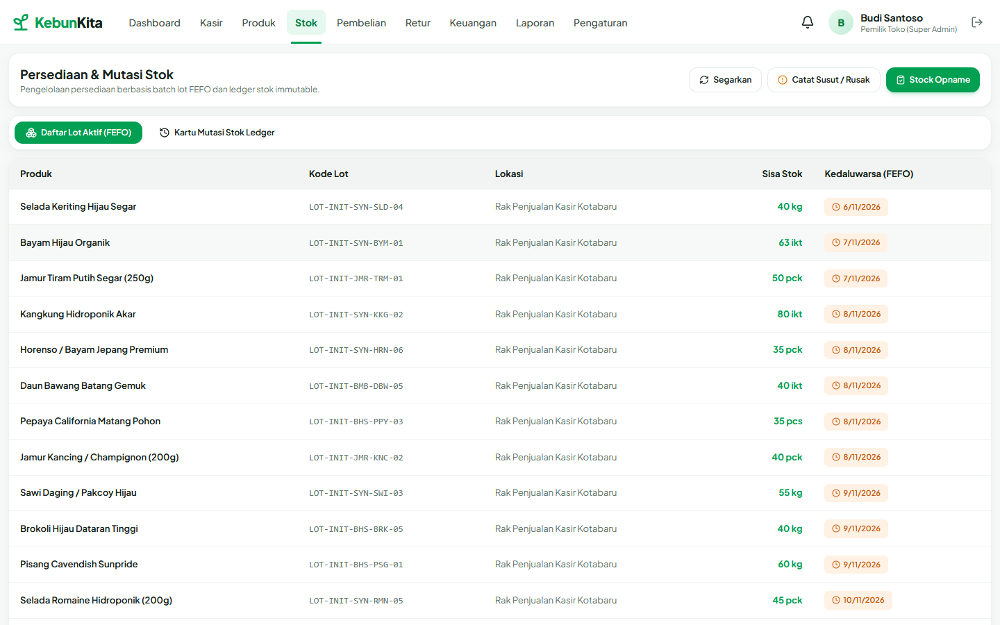</td>
</tr>
</table>

<p align="center">
  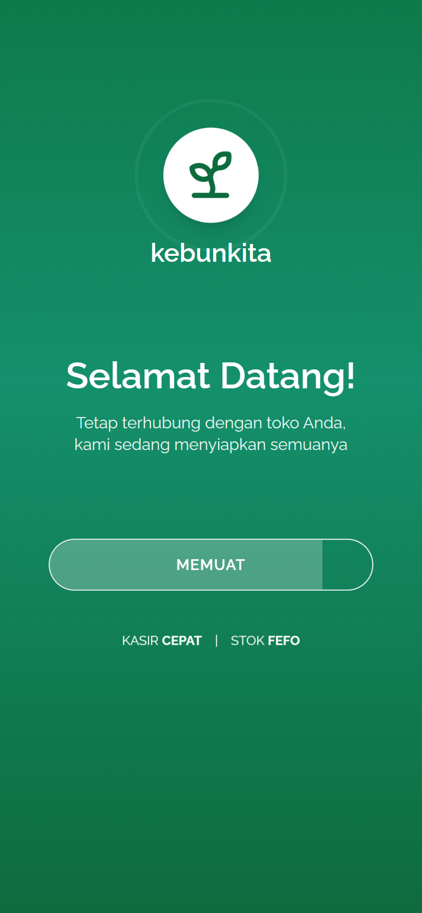
  &nbsp;&nbsp;&nbsp;
  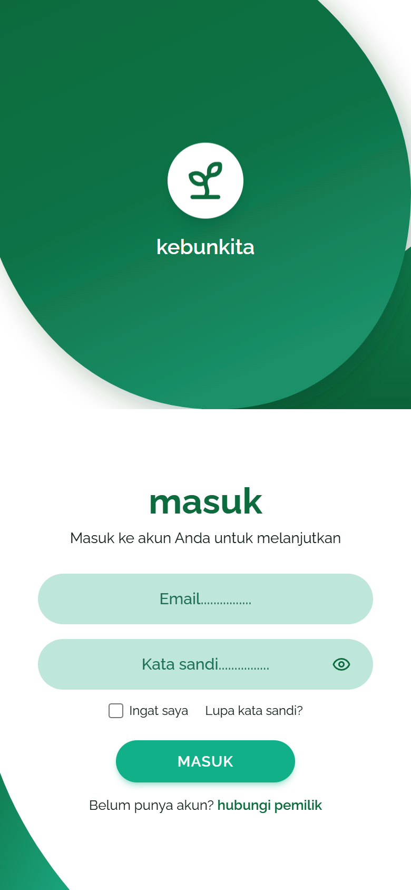
</p>


## 🏗️ Arsitektur

Kebun Kita POS adalah **modular monolith**: satu aplikasi Laravel dengan domain yang terpisah rapi di `app/Services`, dan satu SPA React yang disajikan lewat Vite.

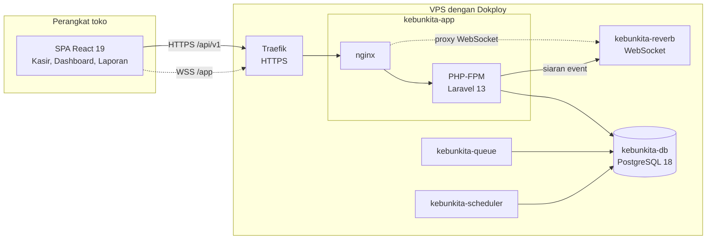

### Tumpukan teknologi

| Lapisan | Teknologi | Peran |
|---|---|---|
| Backend | Laravel 13, PHP 8.5 | REST API `/api/v1`, service layer |
| Autentikasi | Laravel Sanctum | Sesi SPA dengan cookie HttpOnly dan CSRF |
| Realtime | Laravel Reverb, Echo, pusher-js | WebSocket untuk notifikasi transaksi |
| Frontend | React 19, TypeScript, Vite 6 | Single Page Application |
| Tampilan | Tailwind CSS 4, Motion, Lucide | Desain dan animasi |
| Database | PostgreSQL 18 | Data transaksi, sesi, cache, dan antrean |
| Infrastruktur | Docker, nginx, Supervisor, Dokploy | Deployment di VPS |

### Struktur folder

```text
kebun-kita-POS/
├── app/
│   ├── Events/              # Event siaran WebSocket (PenjualanSelesai)
│   ├── Http/Controllers/Api/V1/   # Controller tipis, tanpa logika bisnis
│   ├── Models/              # Model Eloquent berbahasa Indonesia
│   ├── Policies/            # Otorisasi pengguna dan cabang
│   ├── Services/            # Seluruh logika bisnis per domain
│   │   ├── Penjualan/       # Kasir, retur, notifikasi transaksi
│   │   ├── Persediaan/      # Stok, FEFO, susut, opname
│   │   ├── Pembelian/       # PO dan penerimaan barang
│   │   ├── Laporan/         # Dashboard dan laporan
│   │   └── ...
│   └── Support/             # Uang, Qty, Paginasi, ResponsApi, NomorDokumen
├── database/
│   ├── migrations/          # Skema 41 tabel domain
│   └── seeders/             # Data awal dan data demo
├── docker/                  # nginx, PHP, Supervisor, entrypoint
├── docs/                    # Dokumen teknis dan aset README
├── resources/js/
│   ├── fitur/               # Satu folder per menu (kasir, dashboard, ...)
│   ├── komponen/layout/     # Navbar, drawer, preloader, lonceng
│   ├── komponen/ui/         # Kartu, Tombol, Dialog, PopupAlert, Paginasi
│   ├── layanan/             # apiClient dan realtime
│   └── tipe/                # Tipe TypeScript
├── routes/                  # api.php, web.php, channels.php
├── Dockerfile
├── docker-compose.yml
└── .env.production.example
```

### Alur satu transaksi

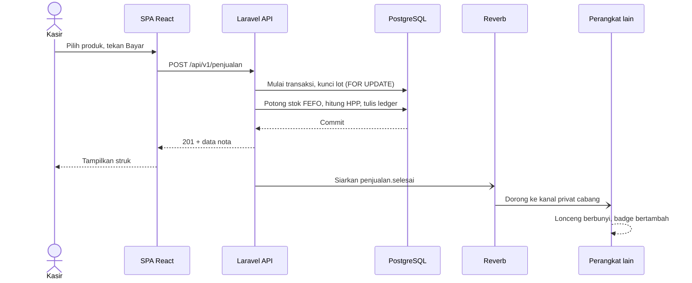

Siaran dijalankan **setelah respons terkirim** dan kegagalannya ditangkap, jadi Reverb yang lambat atau mati tidak pernah menahan atau menggagalkan transaksi kasir.


## 🔔 Notifikasi Realtime

<p align="center"></p>

Lonceng di navbar menampilkan **8 penjualan terakhir** cabang beserta jumlah transaksi yang belum dilihat, dan tautan **Lihat Riwayat Transaksi Lengkap** menuju menu Laporan.

| Kondisi | Perilaku lonceng |
|---|---|
| WebSocket tersambung | Label **Realtime**, transaksi masuk seketika |
| WebSocket terputus | Label **Berkala**, data diperbarui otomatis tiap 15 detik |
| Tersambung kembali | Memuat ulang sekali untuk mengejar transaksi yang terlewat |
| Reverb tidak dijalankan | Aplikasi tetap normal, lonceng memakai mode berkala |

- **Keamanan:** kanal `private-cabang.{id}` hanya bisa dibuka pengguna cabang itu dan pemilik.
- **Hitungan belum dilihat:** waktu terakhir dibuka disimpan di browser, per pengguna dan per perangkat.


## 🗃️ Model Data

Inti relasi transaksi dan persediaan:

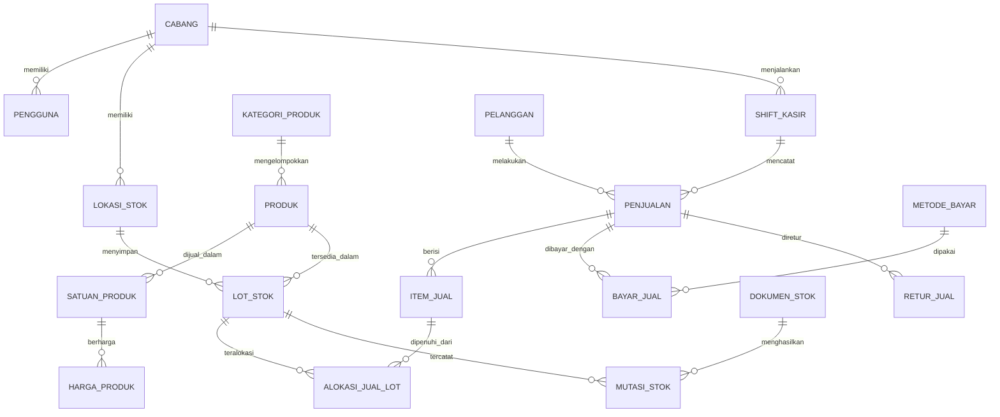

### Aturan bisnis utama

| Aturan | Isi |
|---|---|
| **FEFO** | Lot diurutkan `kedaluwarsa_pada ASC NULLS LAST`, lalu waktu dibuat. Baris dikunci `FOR UPDATE`. |
| **HPP nyata** | HPP item adalah jumlah `qty alokasi × HPP lot`, disimpan di `alokasi_jual_lot`. |
| **Ledger** | Setiap perubahan stok wajib punya `dokumen_stok` dan `mutasi_stok`. `saldo_stok` hanya cache baca. |
| **Snapshot** | Nama dan harga disalin ke `item_jual`, jadi perubahan harga tidak mengubah riwayat. |
| **Uang** | `numeric(18,0)` dan dikirim sebagai string di API, bukan float JavaScript. |
| **Kuantitas** | `numeric(18,3)` untuk berat. |
| **Idempotensi** | `idempotency_key` mencegah penjualan tercatat ganda saat permintaan terkirim ulang. |

Rincian lengkap ada di [docs/ATURAN_BISNIS.md](docs/ATURAN_BISNIS.md), [docs/KAMUS_DATA.md](docs/KAMUS_DATA.md), dan [docs/KEPUTUSAN_TEKNIS.md](docs/KEPUTUSAN_TEKNIS.md).


## 🚀 Mulai Cepat

### Prasyarat

| Kebutuhan | Versi |
|---|---|
| PHP | 8.3 atau lebih baru, dengan `pdo_pgsql`, `bcmath`, `intl`, `gd`, `zip` |
| Composer | 2.x |
| Node.js | 20 atau lebih baru |
| PostgreSQL | 16 atau lebih baru |

### Instalasi

```bash
# 1. Pasang dependensi
composer install
npm install

# 2. Siapkan environment
cp .env.example .env
php artisan key:generate

# 3. Isi DB_* dan REVERB_* di .env, lalu buat database
createdb -U postgres kebun_kita

# 4. Buat tabel dan isi data demo
php artisan migrate --seed

# 5. Bangun aset frontend
npm run build
```

Isi `REVERB_APP_ID`, `REVERB_APP_KEY`, dan `REVERB_APP_SECRET` dengan nilai acak apa saja.

### Menjalankan

Buka tiga terminal:

```bash
php artisan serve         # Aplikasi di http://127.0.0.1:8000
php artisan reverb:start  # WebSocket notifikasi di port 8080
npm run dev               # Hot reload frontend (opsional bila sudah npm run build)
```

Fitur ekspor di latar belakang memerlukan `php artisan queue:work`.

### Akun demo

Seeder development membuat akun berikut. **Jangan pakai kata sandi ini di server publik.**

| Peran | Email | Kata sandi |
|---|---|---|
| Pemilik | `pemilik@kebunkita.id` | `AdminKebunKita2026!` |
| Kasir | `kasir@kebunkita.id` | `KasirKebunKita2026!` |
| Gudang | `gudang@kebunkita.id` | `GudangKebunKita2026!` |

### Skrip yang sering dipakai

| Perintah | Fungsi |
|---|---|
| `npm run typecheck` | Pemeriksaan TypeScript |
| `npm run build` | Build produksi frontend |
| `vendor/bin/pint` | Format kode PHP |
| `php artisan route:list --path=api` | Daftar endpoint |
| `php artisan migrate:fresh --seed` | Reset database development |


## 📡 Referensi API

Semua endpoint berada di bawah `/api/v1` dan, kecuali autentikasi dan health, memerlukan sesi login. Kontrak lebih rinci ada di [docs/KONTRAK_API.md](docs/KONTRAK_API.md).

### Bentuk respons

```jsonc
// Sukses
{ "sukses": true, "pesan": "…", "data": { }, "meta": { "waktu_server": "…" } }

// Gagal
{ "sukses": false, "kode_error": "VALIDASI_GAGAL", "pesan": "…", "detail": { "email": ["…"] } }
```

### Pagination

Semua endpoint daftar menerima `page` dan `per_halaman` (maksimal 100). `per_page` tetap diterima untuk klien lama.

```http
GET /api/v1/produk?page=2&per_halaman=20&q=tomat&kategori_id=…
```

```jsonc
{
  "sukses": true,
  "data": [ ],
  "meta": { "halaman_sekarang": 2, "total_halaman": 7, "total_data": 133, "per_halaman": 20 },
  "links": { "pertama": "…", "terakhir": "…", "sebelumnya": "…", "selanjutnya": "…" }
}
```

<details>
<summary><b>Daftar lengkap 65 endpoint</b></summary>

| Domain | Endpoint |
|---|---|
| Autentikasi | `POST /auth/masuk`, `POST /auth/keluar`, `GET /auth/saya` |
| Pengguna | `GET` `POST /pengguna`, `GET` `PATCH /pengguna/{id}` |
| Cabang | `GET` `POST /cabang`, `GET /cabang/{id}` |
| Produk | `GET` `POST /produk`, `GET` `PATCH` `DELETE /produk/{id}` |
| Kategori & Satuan | `GET` `POST /kategori`, `GET` `POST /satuan` |
| Harga | `POST /harga`, `GET /harga/riwayat/{satuanProdukId}` |
| Pemasok & Pelanggan | `GET` `POST /pemasok`, `GET` `POST /pelanggan` |
| Stok | `GET /stok/saldo`, `GET /stok/lot`, `GET /stok/mutasi`, `POST /stok/susut`, `POST /stok/opname` |
| Lokasi Stok | `GET` `POST /lokasi-stok` |
| Pembelian | `GET` `POST /pembelian`, `GET /pembelian/{id}`, `POST /pembelian/{id}/setujui`, `POST /pembelian/{id}/penerimaan` |
| Shift | `GET /shift/aktif`, `POST /shift/buka`, `POST /shift/tutup`, `POST /shift/mutasi-kas`, `GET /shift/riwayat` |
| Penjualan | `GET` `POST /penjualan`, `GET /penjualan/{id}` |
| Metode Bayar | `GET` `POST /metode-bayar` |
| Pembayaran | `POST /pembayaran/inisialisasi-qris` |
| Retur | `GET` `POST /retur-jual` |
| Notifikasi | `GET /notifikasi/transaksi?batas=8&sejak=…` |
| Dashboard | `GET /dashboard/ringkasan`, `/grafik-penjualan`, `/penjualan-kategori`, `/metode-bayar`, `/top-produk` |
| Laporan | `GET /laporan/penjualan`, `/laporan/laba-rugi`, `/laporan/ekspor-penjualan` |
| Transfer Stok | `GET` `POST /transfer-stok`, `POST /transfer-stok/{id}/terima` |
| Hardware | `GET /hardware/timbangan/status`, `GET /hardware/timbangan/baca` |
| Lainnya | `GET /health` |

</details>


## 🐳 Deploy ke VPS dengan Dokploy

Repositori ini sudah berisi semua yang dibutuhkan: `Dockerfile`, `docker-compose.yml`, konfigurasi `docker/`, dan contoh environment `.env.production.example`.

### Layanan yang berjalan

| Layanan | Fungsi | Port internal |
|---|---|---|
| `kebunkita-app` | nginx + PHP-FPM, menjalankan migrasi saat start | 80 |
| `kebunkita-reverb` | Server WebSocket | 8080 |
| `kebunkita-queue` | Pekerja antrean | - |
| `kebunkita-scheduler` | Penjadwal Laravel | - |
| `kebunkita-db` | PostgreSQL 18 dengan volume `kebunkita_db` | 5432 |

Hanya `kebunkita-app` yang perlu domain. WebSocket `/app/` diteruskan oleh nginx ke Reverb, jadi semua lalu lintas memakai satu domain dan satu sertifikat.

### Prasyarat

- VPS Ubuntu 22.04/24.04 dengan minimal **2 vCPU dan 4 GB RAM**, karena build image cukup berat. Untuk RAM 2 GB, tambahkan swap dulu.
- Dokploy sudah terpasang, dengan port `80`, `443`, dan `3000` terbuka:

  ```bash
  curl -sSL https://dokploy.com/install.sh | sudo sh
  ```

- Subdomain, misalnya `pos.tokoanda.com`, dengan **A record** mengarah ke IP VPS.
- Kode proyek sudah ada di repositori Git (GitHub, GitLab, atau Gitea).

### Langkah 1: Unggah kode ke Git

```bash
git init
git add .
git commit -m "Rilis awal Kebun Kita POS"
git branch -M main
git remote add origin <URL_REPOSITORI_ANDA>
git push -u origin main
```

Berkas `.env` sudah diabaikan oleh `.gitignore`, jadi rahasia lokal tidak ikut terunggah.

### Langkah 2: Buat layanan di Dokploy

1. Buka panel Dokploy di `http://IP_VPS:3000`.
2. Buat **Project** baru, misalnya `kebun-kita`.
3. Pilih **Create Service → Compose**, dengan tipe **Docker Compose** (bukan Stack, karena Stack tidak mendukung `build`).
4. Di tab **General**, sambungkan repositori, pilih branch `main`, dan isi **Compose Path** dengan `./docker-compose.yml`.

### Langkah 3: Buat rahasia

Jalankan di terminal mana pun yang punya `openssl`:

```bash
echo "APP_KEY=base64:$(openssl rand -base64 32)"
echo "DB_PASSWORD=$(openssl rand -hex 24)"
echo "REVERB_APP_ID=$(shuf -i 100000-999999 -n 1)"
echo "REVERB_APP_KEY=$(openssl rand -hex 16)"
echo "REVERB_APP_SECRET=$(openssl rand -hex 24)"
echo "SEED_PASSWORD_PEMILIK=$(openssl rand -base64 18)"
echo "SEED_PASSWORD_STAF=$(openssl rand -base64 18)"
```

Simpan hasilnya di pengelola kata sandi.

### Langkah 4: Isi environment

Buka tab **Environment**, tempel seluruh isi [`.env.production.example`](.env.production.example), lalu ganti semua nilai `GANTI_*`.

| Variabel | Contoh | Catatan |
|---|---|---|
| `APP_URL` | `https://pos.tokoanda.com` | Dengan `https://` |
| `SANCTUM_STATEFUL_DOMAINS` | `pos.tokoanda.com` | Tanpa `https://` |
| `REVERB_ALLOWED_ORIGINS` | `pos.tokoanda.com` | Tanpa `https://` |
| `SEED_DATA_DEMO` | `false` | `true` bila ingin data contoh |

### Langkah 5: Pasang domain

Di tab **Domains**, pilih **Add Domain**:

| Isian | Nilai |
|---|---|
| Service Name | `kebunkita-app` |
| Host | `pos.tokoanda.com` |
| Path | `/` |
| Container Port | `80` |
| HTTPS | Aktif |
| Certificate | Let's Encrypt |

### Langkah 6: Deploy

Tekan **Deploy** dan pantau tab **Deployments**. Build pertama memakan beberapa menit karena ekstensi PHP dikompilasi. Setelah selesai, `https://pos.tokoanda.com/up` harus menjawab status 200.

### Langkah 7: Isi data awal (sekali saja)

Buka **Docker Terminal** pada container `kebunkita-app`, lalu jalankan:

```bash
php artisan db:seed --force
```

Perintah ini membuat cabang, peran, metode bayar, lokasi stok, satuan, kategori, dan akun awal. Dengan `SEED_DATA_DEMO=false`, produk dan transaksi contoh tidak dibuat.

Masuk memakai `pemilik@kebunkita.id` dan nilai `SEED_PASSWORD_PEMILIK`. Setelah itu hapus `SEED_PASSWORD_PEMILIK` dan `SEED_PASSWORD_STAF` dari tab Environment.

> [!WARNING]
> Di mode produksi, seeder berhenti bila kata sandi awal kosong. Ini disengaja agar akun tidak memakai kata sandi yang tertulis di repositori.

### Langkah 8: Deploy otomatis (opsional)

Buka tab **Deployments**, salin **Webhook URL**, lalu tambahkan ke pengaturan webhook repositori. Setiap push ke `main` akan membangun ulang aplikasi, dan migrasi baru berjalan otomatis saat container start.

### Pemeliharaan

**Memperbarui aplikasi:** push ke branch `main`, lalu tekan **Deploy**.

**Mengubah environment:** ubah di tab Environment, lalu tekan **Deploy** agar semua container memuat nilai baru.

**Cadangan database** dari terminal VPS:

```bash
docker exec $(docker ps -qf name=kebunkita-db) \
  sh -c 'pg_dump -U "$POSTGRES_USER" -Fc "$POSTGRES_DB"' > kebunkita-$(date +%F).dump
```

**Memulihkan cadangan:**

```bash
docker exec -i $(docker ps -qf name=kebunkita-db) \
  sh -c 'pg_restore -U "$POSTGRES_USER" -d "$POSTGRES_DB" --clean --if-exists' < kebunkita-2026-11-01.dump
```

Volume `kebunkita_db` dan `kebunkita_storage` adalah named volume, sehingga juga bisa dicadangkan otomatis lewat fitur **Volume Backups** di Dokploy.

### Mencoba Docker di komputer sendiri

Lakukan di **salinan proyek terpisah**, karena langkah ini menimpa `.env` development.

```bash
cp .env.production.example .env   # lalu isi semua nilai GANTI_*
docker compose up -d --build
```

Tanpa HTTPS, ubah `SESSION_SECURE_COOKIE` menjadi `false`, isi `APP_URL`, `SANCTUM_STATEFUL_DOMAINS`, dan `REVERB_ALLOWED_ORIGINS` dengan alamat lokal, lalu tambahkan `ports: ["8088:80"]` sementara pada `kebunkita-app`.


## 🩺 Pemecahan Masalah

| Gejala | Penyebab umum | Solusi |
|---|---|---|
| Deploy gagal: `DB_PASSWORD wajib diisi` | Tab Environment kosong | Isi environment, lalu Deploy ulang |
| Container berhenti: `APP_KEY wajib diisi` | `APP_KEY` kosong | Buat sesuai Langkah 3 |
| Bad Gateway saat dibuka | Domain menunjuk layanan atau port yang salah | Pastikan `kebunkita-app` port `80` |
| Login menghasilkan error 419 | CSRF, domain tidak dikenali | Periksa `SANCTUM_STATEFUL_DOMAINS` dan `APP_URL` |
| Setelah login, API selalu 401 | Cookie sesi ditolak browser | Pastikan `SESSION_DOMAIN=null` dan akses lewat HTTPS |
| Aset memuat `http://` di halaman HTTPS | `APP_URL` salah | Isi `APP_URL` dengan `https://` |
| Lonceng selalu **Berkala** | WebSocket tertolak | Periksa `REVERB_ALLOWED_ORIGINS`, kunci `REVERB_*`, dan container `kebunkita-reverb` |
| Build berhenti tiba-tiba | VPS kehabisan memori | Tambahkan swap 2 GB, lalu Deploy ulang |
| `db:seed` gagal dengan `wajib diisi` | Kata sandi awal kosong | Isi `SEED_PASSWORD_PEMILIK` dan `SEED_PASSWORD_STAF` |
| Waktu transaksi bergeser beberapa jam | Zona waktu tidak sama | Pastikan `APP_TIMEZONE=Asia/Jakarta`; aplikasi dan koneksi database memakai nilai yang sama |

<details>
<summary><b>Perintah diagnosis berguna</b></summary>

```bash
# Dari Docker Terminal container kebunkita-app
php artisan about
php artisan migrate:status
php artisan route:list --path=notifikasi
php artisan config:show broadcasting.default
```

</details>


## 🧭 Status & Keterbatasan

Bagian ini sengaja jujur supaya tidak ada kejutan saat dipakai.

| Area | Status |
|---|---|
| Menu **Keuangan** | Masih halaman kosong; shift dan mutasi kas dikelola dari menu Kasir |
| Tombol **Simpan** di Kasir | Belum menyimpan pesanan; aplikasi menampilkan peringatan |
| **Biaya layanan** | Tampil di tagihan dan struk, tetapi belum tersimpan di database dan laporan |
| **Harga khusus cabang** | Urutan resolusi harga perlu ditinjau, harga umum bisa mengalahkannya |
| **Retur barang rusak** | Alur tidak layak jual belum selaras dengan skema tabel susut |
| **Timbangan digital** | Adapter tersedia; pembacaan belum tersambung ke perangkat fisik, berat diisi manual |
| **QRIS gateway** | Adapter tersedia; perlu kredensial vendor, pembayaran dicatat manual |
| **Hak akses menu** | Peran tersimpan, tetapi semua menu masih tampil untuk semua peran |
| **Lupa kata sandi** | Belum ada; kata sandi diganti oleh pemilik toko |
| **Dropdown pelanggan** | Kasir memuat 20 pelanggan pertama |
| **Pengujian otomatis** | Belum ada test suite fitur; verifikasi saat ini dilakukan lewat browser |


## 📚 Dokumen Lainnya

| Dokumen | Isi |
|---|---|
| [docs/ATURAN_BISNIS.md](docs/ATURAN_BISNIS.md) | Logika domain: satuan, harga, FEFO, HPP |
| [docs/KAMUS_DATA.md](docs/KAMUS_DATA.md) | Definisi tabel dan kolom |
| [docs/KONTRAK_API.md](docs/KONTRAK_API.md) | Kontrak endpoint |
| [docs/KONTRAK_DESAIN.md](docs/KONTRAK_DESAIN.md) | Token dan aturan desain |
| [docs/KEPUTUSAN_TEKNIS.md](docs/KEPUTUSAN_TEKNIS.md) | Keputusan arsitektur |
| [docs/HANDOVER_DEVELOPER.md](docs/HANDOVER_DEVELOPER.md) | Catatan serah terima developer |

<p align="center">
  <br>
  🌱 <b>Kebun Kita POS</b> — segar dari kebun, rapi sampai ke kasir.
</p>
